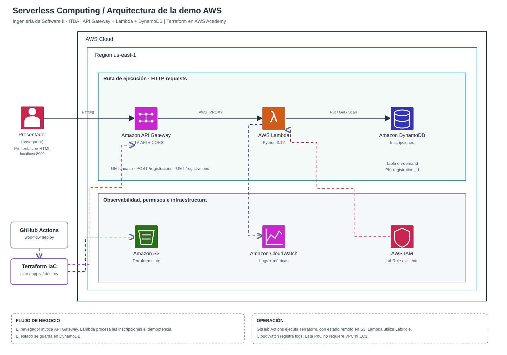

# Serverless Computing — Ingeniería de Software II · ITBA

Trabajo práctico del segundo cuatrimestre de 2026. Presentación HTML **interactiva** de 22 diapositivas para una exposición de **15 minutos**: 10 minutos de fundamentos y decisiones arquitectónicas, más 5 minutos de prueba de concepto. La explicación empieza **sin vendor**, compara alternativas y luego utiliza AWS como caso concreto.

## Contenido

| Archivo | Descripción |
| --- | --- |
| [index.html](index.html) | Presentación 16:9, theme Cloud / Impulse, con botones de demo |
| [aws-demo/template.yaml](aws-demo/template.yaml) | AWS SAM: HTTP API Gateway, Lambda, DynamoDB e IAM |
| [aws-demo/src/app.py](aws-demo/src/app.py) | Backend Python de inscripciones con idempotencia |
| [aws-demo/tests/test_app.py](aws-demo/tests/test_app.py) | Seis pruebas unitarias |
| [docs/GUIA_AWS.md](docs/GUIA_AWS.md) | Despliegue, conexión, observabilidad y limpieza |
| [docs/GUION.md](docs/GUION.md) | Guion y tiempos de exposición |
| [docs/FUENTES.md](docs/FUENTES.md) | Bibliografía |
| [docs/VALIDACION.md](docs/VALIDACION.md) | Pruebas realizadas y limitaciones |

## Abrir la presentación

Clonar el repositorio y ejecutar un servidor HTTP local:

```bash
git clone https://github.com/aggalan/serverless-computing-is2.git
cd serverless-computing-is2
python3 -m http.server 8000
```

Abrir **http://localhost:8000**. Navegar con flechas o espacio. Las diapositivas 18–22 contienen la demo interactiva.

## Demo: dos modos

- **SIMULACIÓN**: funciona directamente en el navegador, sin AWS. Permite registrar participantes ficticios, listar, repetir un identificador para mostrar idempotencia, provocar un conflicto 409 y ejecutar una ráfaga controlada.
- **AWS REAL**: los mismos botones invocan una API desplegada con API Gateway y Lambda, que persiste datos en DynamoDB. En la diapositiva 18 seleccionar AWS REAL y pegar el `ApiUrl` devuelto por el despliegue.

Los resultados de la simulación **no son métricas de AWS**, y una prueba breve de 12 solicitudes no prueba escalabilidad ilimitada.


## Infraestructura AWS: Terraform y diagrama editable



- [Editar diagrama en draw.io](docs/arquitectura-aws.drawio) — abrilo con [app.diagrams.net](https://app.diagrams.net/).
- [Guía completa: Terraform para AWS Academy + pipeline de GitHub Actions](docs/DESPLIEGUE_TERRAFORM_ACADEMY.md).
- [Terraform (IaC)](aws-demo/terraform/main.tf): API Gateway HTTP API → Lambda (Python) → DynamoDB, con CloudWatch y `LabRole` existente.
- [CI de tests y validación](.github/workflows/ci.yml): corre en cada push/PR sin utilizar credenciales AWS.
- [Deploy opcional con Terraform](.github/workflows/deploy-aws.yml): `plan/apply/destroy` manuales, estado remoto S3 y autenticación OIDC (cuenta estándar) o credenciales temporales (Learner Lab).

### AWS Academy: despliegue directo desde GitHub Actions

El pipeline toma las credenciales del Lab desde **GitHub Actions Secrets** (`AWS_ACCESS_KEY_ID`, `AWS_SECRET_ACCESS_KEY`, `AWS_SESSION_TOKEN`). No las guardes en archivos del repo, aunque roten. En cada sesión, copiá los tres valores de **AWS Details → AWS CLI → Show** a [Settings → Actions Secrets](https://github.com/aggalan/serverless-computing-is2/settings/secrets/actions).

Luego: [Actions → Terraform deploy](https://github.com/aggalan/serverless-computing-is2/actions/workflows/deploy-aws.yml) → **Run workflow → main → apply**. El pipeline verifica la identidad, crea si está permitido un bucket S3 privado para Terraform state, despliega API Gateway + Lambda + DynamoDB, y comprueba `GET /health`. Copiá el `api_url` del resumen a la **diapositiva 18**, modo **AWS REAL**.

El primer deploy puede fallar si AWS Academy limita `LabRole`, `iam:PassRole`, Lambda, DynamoDB o S3. Para limpiar elegí **Run workflow → destroy**, usando las mismas credenciales renovadas y el mismo estado. **El bucket S3 para state se conserva** y se limpia por separado cuando ya no se necesita.

**Guía detallada:** [Deploy con Terraform y AWS Academy](docs/DESPLIEGUE_TERRAFORM_ACADEMY.md).

### Alternativa local desde Mac

```bash
export AWS_PROFILE=itba-academy
export AWS_REGION=us-east-1
aws sts get-caller-identity
bash aws-demo/scripts/deploy-academy.sh
```

No mezcles estados locales con el mismo stack gestionado por el pipeline de GitHub. Terraform sigue siendo una **alternativa** al stack AWS SAM original.

## Alternativa original: AWS SAM

Requisitos: cuenta con permisos apropiados, AWS CLI configurada y AWS SAM CLI.

```bash
aws sts get-caller-identity
cd aws-demo
sam build
sam deploy --guided
```

Elegir un stack como `itba-serverless-demo` y la región `us-east-1`. Revisar los recursos y permisos antes de confirmar. En CloudFormation → Outputs, copiar `ApiUrl` y pegarla en la presentación.

Seguir [la guía paso a paso](docs/GUIA_AWS.md).

## Tests

```bash
python3 -m pip install -r requirements-dev.txt
bash scripts/check.sh
```

## Seguridad y limpieza

La API es **pública y deliberadamente sin autenticación** para una demostración educativa breve. No cargar datos personales ni utilizarla en producción. CORS **no es autenticación**. Se pueden generar cargos por los servicios AWS; eliminar el stack al terminar:

```bash
sam delete --stack-name itba-serverless-demo --region us-east-1
```

## Alcance

El repo contiene todos los archivos de texto necesarios para la presentación web y el backend AWS. El PDF y las imágenes de respaldo pueden obtenerse por separado del paquete ZIP original compartido en el chat.


## Cobertura ampliada del cómputo serverless (noviembre de 2026)
La presentación separa **cómputo** (FaaS, contenedores que sirven requests, jobs/batch) de capacidades de **integración, workflow y BaaS**. La taxonomía es didáctica, no excluyente: un job puede ejecutarse en un contenedor. Se introdujo el ciclo de ejecución y un análisis gráfico de vendor lock-in apoyado en fuentes CNCF; la implementación AWS y la demo interactiva siguen intactas. El guion conserva exactamente **10:00 de teoría + 5:00 de demo**. Las fuentes principales son el glosario CNCF y las guías actuales de Cloud Run, Azure Container Apps, Knative y AWS.


## Portabilidad y vendor lock-in
La diapositiva 11 contrasta una arquitectura muy acoplada con otra cuyo núcleo de negocio está separado de los adaptadores de eventos y datos. El artículo de 2018 publicado por CNCF sobre empaquetado de funciones identifica dependencias del código y del runtime como causas importantes del costo de migración. CloudEvents estandariza datos de eventos, pero no todo el stack. El objetivo es explicar el trade-off sin prometer portabilidad perfecta. La nueva diapositiva 5 describe el ciclo de ejecución serverless, sin duplicar el catálogo de modalidades de la diapositiva 4.

### Problemas para conectar la demo

Si en la diapositiva 18 aparece `Failed to fetch`, consultá [Diagnóstico de API Gateway, URL y CORS](docs/DIAGNOSTICO_API_CORS.md). La presentación acepta la URL base y ahora descarta `?utm_source=...`, `#fragment` y `/health` al copiarla desde el navegador. Usá Chrome/Safari y serví `index.html` desde `http://localhost:8000`.
