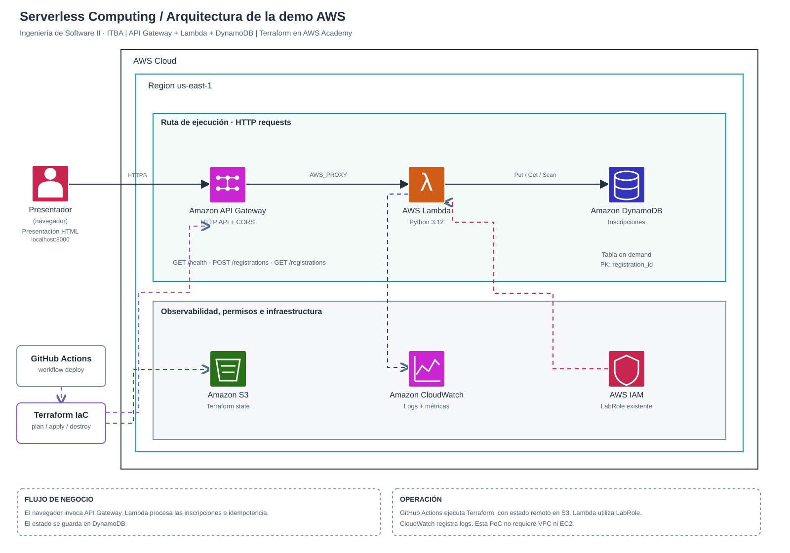

# Desplegar la demo en AWS Academy con Terraform

> Estado: infraestructura preparada como código, **no desplegada** en una cuenta AWS. Validar los permisos de tu Learner Lab: varían según curso, región y docente.

## Qué se despliega



Abrí y editá el archivo [arquitectura-aws.drawio](arquitectura-aws.drawio) en [diagrams.net](https://app.diagrams.net/).

- Presentación HTML local: envía GET y POST.
- API Gateway HTTP API: recibe `GET /health`, `POST /registrations` y `GET /registrations`.
- AWS Lambda Python 3.12: procesa solicitudes e implementa idempotencia.
- DynamoDB on-demand: guarda inscripciones por `registration_id`.
- CloudWatch Logs: contiene los logs de Lambda, con retención de 3 días.
- IAM: Terraform referencia un rol **existente**, por defecto `LabRole`; no crea roles ni políticas.

El endpoint es **público y sin autenticación**, únicamente para demo con datos ficticios. CORS `*` permite la llamada desde el navegador, pero no protege la API. Revisar costos y eliminar los recursos al terminar.

## Opción A: AWS Academy Learner Lab, recomendada (despliegue desde Mac)

### 1. Iniciar sesión de AWS Academy

En el portal de AWS Academy Learner Lab:

1. `Start Lab` y verificar que el laboratorio esté activo.
2. En `AWS Details → AWS CLI → Show`, copiar las **tres credenciales temporales**.
3. En la Mac, guardarlas en `~/.aws/credentials` con perfil `itba-academy`. **Nunca** en el repositorio, issues, chat, capturas, workflows ni scripts.

Ejemplo de estructura (reemplazar los valores con las credenciales del lab, sin publicarlas):

```ini
[itba-academy]
aws_access_key_id = TU_ID_TEMPORAL
aws_secret_access_key = TU_CLAVE_TEMPORAL
aws_session_token = TU_TOKEN_TEMPORAL
```

```bash
chmod 600 ~/.aws/credentials
export AWS_PROFILE=itba-academy
export AWS_REGION=us-east-1
aws sts get-caller-identity
```

Si expiran, obtené nuevas credenciales desde Academy; **no son permanentes**. Verificá las regiones habilitadas en el Readme del lab.

### 2. Instalar herramientas

- [AWS CLI v2](https://docs.aws.amazon.com/cli/latest/userguide/getting-started-install.html)
- [Terraform CLI >=1.10](https://developer.hashicorp.com/terraform/install)
- `python3` y `curl`, normalmente disponibles en macOS.

### 3. Clonar y validar el código

```bash
git clone https://github.com/aggalan/serverless-computing-is2.git
cd serverless-computing-is2
python3 -m pip install -r requirements-dev.txt
python3 -m unittest discover -s aws-demo/tests -v
```

### 4. Provisionar recursos

```bash
export AWS_PROFILE=itba-academy
export AWS_REGION=us-east-1
bash aws-demo/scripts/deploy-academy.sh
```

El script hace `aws sts get-caller-identity`, `terraform init`, `terraform plan`, `terraform apply`, muestra `api_url` y consulta `GET /health`. No guarda secretos.

También podés hacerlo manualmente:

```bash
cd aws-demo/terraform
terraform init
terraform plan
terraform apply
terraform output -raw api_url
```

Terraform genera `lambda.zip` desde `aws-demo/src/app.py`. No hace falta hacer `pip install boto3` dentro del ZIP porque la runtime AWS Python lo incluye en esta PoC.

**Atención a IAM:** el módulo utiliza `arn:aws:iam::<account-id>:role/LabRole`, calculado automáticamente con el ID de la cuenta activa. Si tu entorno tiene otro rol, cambialo con `-var="lambda_role_name=OTRO"` o `lambda_execution_role_arn`. El rol debe permitir el acceso requerido a DynamoDB y CloudWatch. El usuario del lab debe poder crear Lambda, DynamoDB, API Gateway, CloudWatch y ejecutar `iam:PassRole` sobre el rol seleccionado. Algunos Learner Labs prohíben parte de estas acciones: **si falla por permisos, no se resuelve modificando el código**; habrá que usar un rol autorizado o pedirlo al docente.

No apliques el stack SAM y Terraform sobre los mismos nombres/recursos: son **dos alternativas de despliegue**. Este módulo usa `-tf` en el nombre para evitar colisiones.

### 5. Conectar la presentación

```bash
python3 -m http.server 8000
```

Abrí <http://localhost:8000> y andá a la **diapositiva 18**. Elegí `AWS REAL`, pegá exactamente el `api_url` de Terraform, y presioná `GET /health`. Luego probá registrar, listar, repetir el mismo ID y la ráfaga.

Otra prueba por terminal:

```bash
cd aws-demo/terraform
URL=$(terraform output -raw api_url)
curl -fsS "$URL/health"
curl -fsS -X POST "$URL/registrations" -H 'Content-Type: application/json' \
  -d '{"request_id":"demo-test-00001","name":"Ada"}'
curl -fsS "$URL/registrations"
```

Para observabilidad, abrí CloudWatch → Logs → Log groups → `/aws/lambda/itba-serverless-demo-tf-api`. Las métricas agregadas pueden demorar en aparecer.

### 6. Eliminar recursos

Después de la exposición, y antes de que venzan las credenciales:

```bash
cd aws-demo/terraform
terraform destroy
```

La tabla DynamoDB también se elimina (se perderán las inscripciones ficticias). Si la sesión ya venció, renová credenciales y ejecutá `destroy`. **No borres el archivo de estado local antes de destruir**.

## Opción B: pipeline GitHub Actions — AWS Academy (desde GitHub, sin configurar CLI local)

### Configuración inicial (una vez por sesión del laboratorio)

1. Activá **Start Lab** en AWS Academy.
2. Abrí **AWS Details → AWS CLI → Show**.
3. En el repositorio privado, abrí [Settings → Secrets and variables → Actions](https://github.com/aggalan/serverless-computing-is2/settings/secrets/actions) y cargá tres **Repository secrets** con los nombres exactos:
   - `AWS_ACCESS_KEY_ID` ← valor `aws_access_key_id`
   - `AWS_SECRET_ACCESS_KEY` ← valor `aws_secret_access_key`
   - `AWS_SESSION_TOKEN` ← valor `aws_session_token`
4. En **Variables**, configurá `AWS_REGION` si tu laboratorio utiliza otra región; si no, se usa `us-east-1`. El rol Lambda por defecto es `LabRole`. **No hace falta configurar `TF_STATE_BUCKET`** para la primera prueba.
5. Andá a [Actions → Terraform deploy (explicit opt-in)](https://github.com/aggalan/serverless-computing-is2/actions/workflows/deploy-aws.yml), elegí **Run workflow → main → apply** y ejecutalo. Para revisar sin crear recursos, elegí `plan`.

El workflow obtiene las credenciales directamente de los secretos cifrados de GitHub. **No intenta leerlas del código**, ni las imprime. Cada vez que tu sesión de Academy expire, reemplazá las tres entradas en GitHub; que las credenciales sean temporales no las vuelve públicas.

Al completar `apply`, abrí el run y buscá `API desplegada` en el resumen. Copiá el `api_url` a la **diapositiva 18 → AWS REAL** y probá `GET /health`.

### Estado Terraform en S3 (bootstrap automático)

Los runners de GitHub son efímeros; Terraform necesita un estado persistente para que `apply` y `destroy` apunten a los mismos recursos. El workflow ahora:

1. Comprueba la identidad de AWS con `aws sts get-caller-identity`.
2. Calcula un nombre de bucket específico de cuenta y región: `itba-serverless-is2-tfstate-<account-id>-<region>`.
3. Intenta crearlo si no existe, usando la sesión de Academy.
4. Bloquea acceso público, solicita cifrado SSE-S3 y habilita versionado si los permisos lo permiten.
5. Ejecuta Terraform con backend cifrado S3 y bloqueo nativo `use_lockfile=true`.

Se puede reemplazar el bucket calculado definiendo la variable opcional `TF_STATE_BUCKET` con un bucket S3 privado existente. El bucket de estado **permanece después de `destroy`** para conservar el historial y el bloqueo: borralo por separado solo cuando no quede ningún estado en uso.

**Si el Lab restringe `s3:CreateBucket`, `s3:PutBucketEncryption`, `iam:PassRole`, API Gateway, DynamoDB o Lambda, el deploy fallará con `AccessDenied`**. Las restricciones varían por laboratorio; el script no puede saltarlas. Para resolverlas, revisar permisos con el docente o utilizar un bucket privado existente y el rol autorizado.

### CI y automatización

- `.github/workflows/ci.yml`: pruebas Python y `terraform validate` automáticamente en push/PR, **sin acceder a AWS**.
- `.github/workflows/deploy-aws.yml`: deploy manual `plan/apply/destroy`; por defecto **no aplica cambios en cada push**. En AWS Academy es mejor mantener `AUTO_DEPLOY=false` porque las credenciales vencen.
- En una cuenta AWS estándar, es preferible un rol con GitHub OIDC en lugar de claves de sesión.

### Destruir infraestructura

Antes de terminar el Lab, andá al mismo workflow y seleccioná **Run workflow → destroy**. Debe reutilizar el mismo bucket de estado y la misma región. La tabla DynamoDB se eliminará junto con las inscripciones ficticias; el bucket de Terraform state no se borra automáticamente.

### No mezclar Terraform local y remoto

Si ya aplicaste Terraform desde tu Mac con state local, **no ejecutes `apply` en Actions sobre esos mismos recursos**. Primero hay que migrar el state o destruirlos desde el directorio local original, y luego empezar el flujo remoto. No subas `*.tfstate` a GitHub.


## Problemas frecuentes

| Síntoma | Causa probable | Qué hacer |
| --- | --- | --- |
| `ExpiredToken` o `InvalidClientTokenId` | Sesión AWS Academy vencida | Renovar las 3 credenciales de CLI |
| `iam:PassRole` o `AccessDenied` | Restricciones Learner Lab / rol incorrecto | Revisar rol y permisos del laboratorio |
| `ResourceNotFoundException` DynamoDB | LabRole no tiene acceso o tabla equivocada | Verificar variables Lambda y permisos DynamoDB |
| CORS bloqueado en navegador | URL incorrecta o configuración preflight | Pegar `api_url` sin rutas, revisar HTTP API |
| `terraform init` no encuentra state bucket | No pudo crearse el bucket privado, región incorrecta o permisos S3 | Revisar el paso de bootstrap o definir `TF_STATE_BUCKET` |
| `AlreadyExists` en Terraform | SAM previo o state local/remoto mezclado | Identificar recurso; no borrar state a ciegas |
| GitHub Actions falla tras varias horas | Credenciales de Academy temporales | Actualizar secrets o usar despliegue local |

## Fuentes técnicas

- [AWS Academy Learner Lab: restricciones y LabRole (AWS Builder Center)](https://builder.aws.com/content/32E1EQtdsojEIqMZ4haf7CYLBuE/teaching-ai-agent-to-work-inside-aws-academy-learner-lab)
- [Terraform + API Gateway + Lambda (HashiCorp)](https://developer.hashicorp.com/terraform/tutorials/aws/lambda-api-gateway)
- [Backend S3 con bloqueo nativo (HashiCorp)](https://developer.hashicorp.com/terraform/language/backend/s3)
- [GitHub Actions OIDC con AWS](https://docs.github.com/en/actions/how-tos/secure-your-work/security-harden-deployments/oidc-in-aws)
- [Credenciales temporales AWS (IAM)](https://docs.aws.amazon.com/IAM/latest/UserGuide/id_credentials_temp_use-resources.html)
